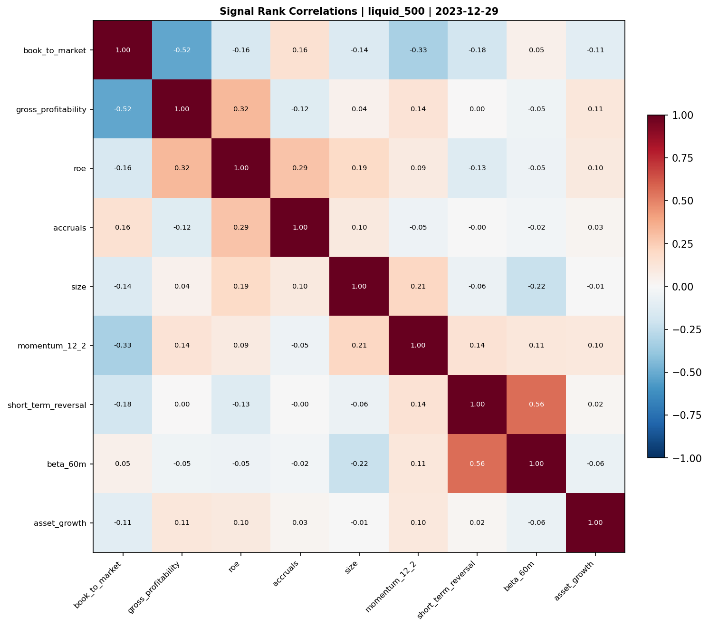

# Optlab Research

**A Python, DuckDB and Polars workbench for systematic equity research.**

Separate data access, signal definitions and portfolio evaluation so a research question can be traced from its inputs to its diagnostics. Developed for research workflows associated with Northeastern's 360 Huntington Fund and Options Club.

**Start here:** [signal registry](config/signals.yaml) | [universe SQL](optlab_research/universes/builder.py) | [backtest engine](optlab_research/backtest/engine.py) | [notebook guide](notebooks/README.md)

## What the repository demonstrates

- **Research configuration:** ten registered signals and four universe presets, with Pydantic schema validation and reusable Python implementations for multi-step factors.
- **SQL/data engineering:** DuckDB queries over an external Parquet-backed data lake; dated security identifiers, fundamentals-availability gates and explicit cross-sectional inputs.
- **Portfolio evaluation:** monthly signal portfolios, weighting and transaction-cost modules, gross/net result objects, saved run manifests and HTML reporting.
- **Options-data infrastructure:** IBKR snapshot collection, Parquet storage, scheduling and monitoring examples. These require a separately configured brokerage/data connection.

This is a research workbench, not a production trading service or a claim of out-of-sample alpha.

## Inspect an actual artifact



*Saved cross-sectional diagnostic: nine signals, one universe and one date. Correlation is not evidence of predictive performance. The [source notebook](notebooks/examples/cross_section_summary.ipynb) and [distribution chart](notebooks/examples/cross_section_histograms.png) provide context; these are archived outputs, not freshly rerun results.*

## Current implementation, not a dated roadmap

| Area | Present in this checkout | Boundary |
|---|---|---|
| Signals | [Registry](optlab_research/signals/registry.py), [compute layer](optlab_research/signals/compute.py), [five library modules](optlab_research/signals/library/) | Data requirements differ by signal; a registry entry does not guarantee coverage. |
| Universes | [Four presets](config/universes.yaml) and [builder](optlab_research/universes/builder.py) | `russell1000`/`russell3000` are size-ranked approximations, not licensed historical index membership. |
| Backtests | [Engine](optlab_research/backtest/engine.py), [portfolio construction](optlab_research/backtest/portfolio.py), [cost-model research](optlab_research/backtest/tcost.py), [results](optlab_research/backtest/result.py) | Net aggregation supports no costs or flat costs. Spread/impact proxies are uncalibrated and explicitly blocked in backtest runs pending reconciliation. |
| Reporting | [HTML report generator](optlab_research/reporting/report.py) and [example](notebooks/examples/08_report_generation.ipynb) | Not a hosted dashboard or an independently validated performance record. |
| IBKR | [Collector/storage/scheduler](optlab_research/ibkr/) and [configuration](config/ibkr.yaml) | External session, permissions and market-data subscriptions required. |
| Planned / not implemented | Factor attribution and the ORATS endpoint | These entry points explicitly raise `NotImplementedError`; no attribution or provider result is claimed. |

## Quick start: inspect and test without market-data credentials

Use **Python 3.11+** and run from the repository root. The nested `optlab-research/` directory is an older copy, not the installation target.

```bash
git clone https://github.com/JoshGutierrez56/Optlab-Research.git
cd Optlab-Research
python -m pip install -e ".[dev]"
python -c "from optlab_research.signals.registry import load_signals; print(load_signals().names())"
python -m pytest tests -q
```

The tests use synthetic fixtures; no WRDS account, broker login or data download is needed. A passing fixture test is not a validation of every real-data path.

### With your own prepared data lake

The external `optlab` package must be installed separately and provide `config/tables.yaml`, `data/` and `db/research.duckdb`. Licensed CRSP/Compustat data and an operational data lake are **not** supplied by this checkout; the root `optlab.db` is not a ready-to-query research dataset.

Use the implemented lower-level interfaces explicitly:

```python
from optlab_research import open_connection
from optlab_research.universes.builder import get_universe
from optlab_research.signals.compute import compute_signal

with open_connection(optlab_root="/path/to/your/optlab") as con:
    universe = get_universe("liquid_500", "2023-12-29", con)
    momentum = compute_signal(
        "momentum_12_2", "2023-12-29", con, universe=universe
    )
    print(momentum.head())
```

The universe builder expects CRSP prices and security-name histories, delisting dates, dated CCM links and Compustat fundamentals. Beta and idiosyncratic-volatility signals additionally need the relevant Fama-French tables. Inspect each [signal definition](config/signals.yaml) before running it.

## Data and interpretation limits

- **Availability is not vintage reconstruction.** The universe SQL gates fundamentals using `COALESCE(rdq, datadate + 90 days) <= asof`. This is an availability convention, not proof that restated values, identifier mappings and every downstream join reproduce the information available historically. Supplied universe frames remain the caller's responsibility.
- **Grain and coverage matter.** Check one security per cross-section, identifier-link validity, stale prices and missing/delisting returns. `liquid_500` currently ranks monthly-dollar-volume inputs; it is not a daily-liquidity execution model.
- **Bounded API verification.** The public workbench preserves a supplied signal universe and applies additional price/capitalization screens after the named universe preset. Synthetic regression checks cover those paths; they do not certify every external data-lake integration.
- **Costs are explicit assumptions.** Positive `wb.backtest(..., tcost_bps=...)` selects flat costs per unit of absolute traded portfolio weight; zero disables costs. Long and short charges both reduce portfolio returns once, including position reductions and exits. The model compares consecutive target weights, not drifting share holdings, and charges entry and exit separately. Hand-calculated fixtures check the arithmetic; spread/impact proxies are not enabled for backtests. Saved notebook net results predate this correction and have not been rerun.
- **Results are specification-dependent.** Within each leg, the backtest drops missing forward returns and renormalizes surviving holdings. Dates with no observed returns are retained with null returns; if only one leg has returns, `ls_ret` uses that available leg. Its reported `sharpe_ls` uses geometric annualized return divided by annualized volatility, not the conventional arithmetic excess-return Sharpe. Review the [implementation](optlab_research/backtest/result.py) before comparison with another system.
- **Scope still to complete:** attribution, provider integration and end-to-end real-data validation. The [June audit](AUDIT.md) is historical context, not a current completion certificate.

## Repository map

| Path | Purpose |
|---|---|
| [`config/`](config/) | Signal, universe and IBKR configuration |
| [`optlab_research/`](optlab_research/) | Current package: SQL access, factors, portfolios, reporting and collectors |
| [`notebooks/`](notebooks/) | Research examples, replication studies and saved diagnostics |
| [`tests/`](tests/) | Synthetic signal and portfolio checks |
| [`scripts/`](scripts/) | Snapshot collection entry points |

The strongest contribution here is the separation of research logic from data plumbing, with assumptions exposed for inspection and extension.
